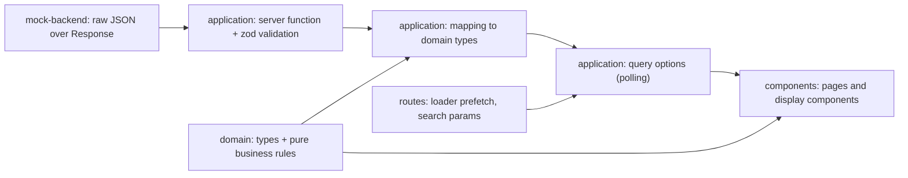

# Robot Fleet Management

A fleet manager's view of a robot fleet: what the whole fleet is doing right now, which robots need attention, where they are, and the details of a single robot.

## Getting started

Runs on node v24.22.3 - a `.nvmrc` file is provided for your convenience:

```bash
nvm install 
corepack enable
pnpm install
pnpm dev        # http://localhost:3000
```

Other scripts:

```bash
pnpm test       # Vitest unit tests
pnpm check      # Biome lint + format check
pnpm build      # production build (Nitro server in .output/)
```

There is nothing to configure: the backend is mocked inside the app.

### Docker

The `Dockerfile` builds the app in several stages and runs the production server as a non-root user:

```bash
docker build -t robot-fleet-management .
docker run --rm -p 3000:3000 robot-fleet-management
```

The app is then available at http://localhost:3000.

## What I chose to build, and why

I focused on the **user interface**. That is where I want to show what I am good at: turning raw telemetry into something a person can act on quickly, on a codebase that is structured so it stays easy to change.

I started from the question a fleet manager opens this screen with: *"Is anything wrong, and where?"* That shaped the features:

- **Fleet overview** (`/`)
  - Summary cards: robots, robots needing attention, active robots, average battery.
  - Site and status filters, stored in the URL so a filtered view can be shared or bookmarked.
  - A **site map** per site, showing robot positions to scale, their heading, and a red ring around robots that need attention.
  - A table of all robots, **sorted by attention** (errors first, then offline, then critical battery), with a warning icon whose tooltip explains why.
- **Robot detail** (`/robots/:id`)
  - Attention alerts that say what is wrong and what it means.
  - Cards for battery, position and heading, and last report.
  - A log of recent events.
- **Near-live data**
  - Both pages poll every 5 seconds.
  - Between polls the page re-evaluates time-based state every second, so "last report" counts up and a robot that stops reporting turns *offline* without waiting for the next request.
- **The states that real data produces**
  - Loading skeletons, a "robot not found" page, an error page with retry.
  - A "lost connection, showing last data" notice when a poll fails, empty states for sites without robots, and invalid URL filters that are dropped instead of erroring.
- **Polish:** a system / light / dark theme switcher (no flash of the wrong theme on load), view transitions between pages, and a stable table layout that does not jump while values update.

## Architecture

The code is split into layers with a clear direction of dependency:



Decisions worth calling out:

- **Reported status vs. effective status.** A robot can report `active`, `idle`, `charging` or `error`, but it can never report being offline. *Offline* is something we infer when telemetry has been missing for more than 10 seconds, about ten missed reports. The domain keeps these two concepts apart, and everything the user sees uses the effective status. A robot whose last report was an error, but which has since gone silent, is shown as offline: its last known error state can no longer be trusted.
- **Time is a parameter.** Every rule that depends on time (`isStale`, `getEffectiveStatus`, `getAttentionReasons`, `summarizeFleet`, …) takes `now` as an argument. The rules stay deterministic and trivial to test, and the UI can re-evaluate them every second without refetching.
- **The trust boundary is the server function.** The mock backend deliberately speaks its own language: snake_case fields, ISO timestamps, `warn` instead of `warning`. It returns a real `Response` with a status code, including a 404. The server function:
  1. Validates the robot id it receives.
  2. Turns a 404 into a "not found" page.
  3. Parses the body with zod, logging and throwing if it does not match the contract.
  4. Maps the result into domain types.

  Nothing unvalidated or backend-shaped reaches a component.
- **Filtering happens in the browser.** Whether a robot counts as "offline" depends on the current time, so the server cannot filter by status once and be correct a second later. At this fleet size, loading the whole fleet and filtering with the domain's `filterRobots` is simpler and always correct.
- **Summary cards follow only the site filter.** Choosing "Offline" filters the table and maps, but the cards keep showing the whole site, so the manager does not lose context.
- **Server rendering loads data only** (`ssr: "data-only"`). Route loaders prefetch data on the server, but pages render in the browser. This view is all live, time-relative values ("3 seconds ago"), which would always differ between server and browser render and cause hydration mismatches. Server-rendered HTML is worth little for an internal tool behind a login.

## What I faked or left out, and why

**Faked**

- **The robot simulator and the backend.** `src/mock-backend/robot-backend.ts` holds eight robots across three sites. Values are derived from the current time: one robot drives a loop with a draining battery, and past events are anchored to when the server started, so they age naturally. It covers the edge cases on purpose: a robot in error, one that went silent, one with a critical battery that is not charging, one with a critical battery that *is* charging (not flagged), and a site with no robots. It sits behind the same `Response` + validation boundary a real API would, so replacing it means changing one call per server function.

**Left out**

- **Authentication, users, multi-tenancy.** Necessary in production, but they would not show anything interesting about this problem.
- **Ingestion and storage.** Out of scope for a UI focus.
- **History.** No battery chart or position trail on the detail page; that needs a time-series backend I chose not to fake.
- **Alerting and acknowledgement.** A manager cannot yet mark an issue as "seen" or assign it.
- **Internationalisation.** The UI is English only, and all number and date formatting uses one fixed locale (`APP_LOCALE`).
- **Real floor plans.** The site map is a scaled grid, rendered as an svg, not a map of the actual building.

## Trade-offs

- **Polling instead of server push.** A 5 second poll is simple, robust (the query layer handles retries, background tabs and stale data) and good enough for a manager's view. Robots report about once per second, so a truly live view would use SSE or WebSockets. Because time-based state is re-evaluated every second in the browser, the most important signal (a robot going offline) shows up promptly even with polling.
- **Loading the whole fleet in one request.** Fine for dozens of robots, not for thousands (see below).
- **Mock state lives in memory.** Restarting the dev server resets event times. Acceptable for a mock.

## What I would do differently in production or with more time

- **Server push** (SSE or WebSockets) for telemetry, keeping the query cache as the single place data lives in the browser.
- **Scale for large fleets:**
  - Server-side pagination, sorting and filtering, with the backend computing effective status from a shared definition of "stale".
  - Virtualised tables.
  - A summary endpoint, so the cards do not need every robot.
- **Generated API types** from an OpenAPI spec, with zod schemas generated from them, so the contract has one source of truth.
- **More tests:** component tests for the display logic, and end-to-end tests (Playwright) for the main flows: filtering, opening a robot, offline and error states.
- **A mobile layout.** A fleet table that scrolls sideways is a poor fit for a phone; I would show the robots needing attention as cards first, with the full list secondary.
- **Robot history and alert workflows:** battery and position history, acknowledging and assigning issues, notifications.
- **Accessibility and dark mode review.** Check contrast of the status colours on dark backgrounds, and run an audit with assistive technology.
- **Observability:** send the validation and fetch errors that are currently logged to error monitoring, so a backend contract change is noticed immediately.

## Tech stack

[TanStack Start](https://tanstack.com/start) (router, server functions, Nitro), [TanStack Query](https://tanstack.com/query), [zod](https://zod.dev), [shadcn/ui](https://ui.shadcn.com) on [Base UI](https://base-ui.com), [Tailwind CSS](https://tailwindcss.com) v4, [Vitest](https://vitest.dev), [Biome](https://biomejs.dev).
