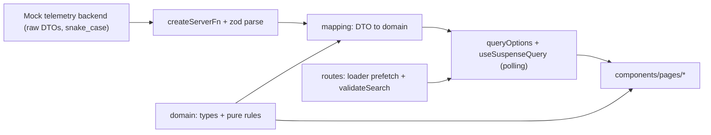

# Robot Fleet Management UI

Build the fleet-manager UI (fleet overview + robot detail) on the existing TanStack Start starter, following the partner portal's domain / application / components layering. Data comes from a mocked "telemetry backend" behind server functions, validated with zod, mapped into domain types, and polled for a near-live view.

## Architecture (mirrors partners-portal-frontend)

Conventions to keep from this repo, not the portal: the `#/` import alias, biome double quotes, and tabs.

## Domain: `src/domain/`

- `robot/types.ts` defines `ROBOT_STATUSES` as a const object, following the same pattern as `DEVICE_STATUSES` in the portal. The statuses are `active | idle | charging | error | offline`. The file also defines `Robot`, `Position` (x/y in site metres plus heading), `TelemetrySample` (timestamp, battery, position, status) and `RobotEvent` (error or warning with a timestamp).
- `robot/robot-health.ts` holds pure business rules:
  - Battery thresholds: `BATTERY_LOW = 20` and `BATTERY_CRITICAL = 10`.
  - `isStale(lastSeen, now)`: a robot counts as stale when it has not reported for more than 10 s. Telemetry arrives at about 1 Hz, so this is 10 missed reports.
  - `effectiveStatus`: shows a stale robot as `offline`.
  - `needsAttention`: true for error, critical battery or stale.
  - `ATTENTION_ORDER`: sort order that puts problem robots first.
- `site/types.ts` defines `Site` (id, name, width/height in metres for the map).
- `fleet/types.ts` + `fleet/fleet-summary.ts`: `FleetSummary` holds counts per status, how many robots need attention, and average battery. `summarizeFleet(robots)` computes it.

## Application: `src/application/`

- `telemetry-backend/` acts as the fake external system, standing in for `types/generated` plus the real HTTP backend:
  - `telemetry-dtos.ts`: zod schemas for the raw API shape (snake_case, ISO timestamps, `battery_pct`, and so on). This is the trust boundary.
  - `mock-telemetry.ts`: a constant list of sites and robots plus a deterministic, time-based generator:
    - Robots move along loops, batteries drain and recharge, and the output is derived from `Date.now()`, so successive polls show movement.
    - It includes edge cases on purpose: one robot in error, one stale, one with critical battery, and one site with no robots.
- `fleet/fleet-api.ts`: `fetchFleet = createServerFn({ method: "GET" })`. It reads the mock, runs `fleetResponseSchema.parse(raw)` and maps the result. If parsing fails, it logs and throws, following the portal's error pattern.
- `fleet/fleet-mapping.ts`: maps DTOs to `Robot[]` and `Site[]` (dates become `Date`/epoch, snake_case becomes camelCase).
- `fleet/use-fleet.ts`: `fleetQueryOptions` with `refetchInterval: 2000`, and `useFleet()` built on `useSuspenseQuery`.
- `robot/robot-api.ts`: `fetchRobot = createServerFn(...).inputValidator(z.object({ robotId: z.string() }))`. It returns the robot, its last ~5 min of telemetry history and recent events, and throws `notFound()` when the id is unknown.
- `robot/robot-mapping.ts` and `robot/use-robot.ts` (`robotQueryOptions(robotId)`), plus `index.ts` barrels like the portal's.

## Components: `src/components/`

These components only display data. They get it from hooks or props and use domain helpers for decisions.

- `pages/fleet-overview/`:
  - `fleet-overview.tsx`: the page.
  - `components/fleet-summary-cards.tsx`: status counts and an attention count.
  - `components/attention-list.tsx`: problem robots first.
  - `components/robot-table.tsx`: name, site, status badge, battery bar, last seen, with a link to the detail page.
  - `components/fleet-filters.tsx`: site and status filters, stored in the URL.
  - `components/site-map.tsx`: an SVG plot of robot positions per site.
- `pages/robot-detail/`:
  - `robot-detail.tsx` and `components/robot-header.tsx`.
  - `components/battery-chart.tsx`: an SVG sparkline of battery history, with no chart dependency.
  - `components/position-map.tsx`: current position plus a trail.
  - `components/event-log.tsx` and `components/telemetry-stats.tsx`.
- `shared/`: `status-badge.tsx`, `battery-indicator.tsx`, `relative-time.tsx`, `error/route-error.tsx`, `not-found/not-found.tsx`.
- `ui/`: shadcn components added with `pnpm dlx shadcn@latest add card badge table progress select skeleton tooltip`.

## Routes: `src/routes/`

- `index.tsx`: the fleet overview.
  - `validateSearch` uses a zod schema for `{ site?, status? }`.
  - `loader` prefetches `fleetQueryOptions`.
  - It sets `errorComponent` and `pendingComponent` (skeleton).
- `robots/$robotId.tsx`: the loader prefetches `robotQueryOptions(params.robotId)`, and the route sets `notFoundComponent`.
- `__root.tsx`: page title, app shell header. The starter `LocaleSwitcher` and demo content are removed. Paraglide stays out of scope, and the README will say so.

## Tooling and quality

- Add `zod` and `vitest`.
- Unit tests:
  - `robot-health.test.ts`: staleness, attention and sorting.
  - `fleet-summary.test.ts`.
  - `fleet-mapping.test.ts`: valid DTOs map correctly, and invalid DTOs are rejected by the schema.
- `pnpm check` and `pnpm build` must pass.

## README

Covers:

- Why the UI only.
- What is faked: the backend and simulator are replaced by a deterministic server-side mock behind the same server-function boundary, so a real API swap would only touch `application/*-api.ts`.
- The polling vs SSE/WebSocket trade-off.
- What is left out: auth, multi-tenant sites, i18n, alerting/acknowledgement, historical storage, map tiles.
- What I would do in production: server push, virtualised tables for large fleets, OpenAPI-generated DTOs, and e2e tests.

## Change of approach: robot detail first

To keep scope small, the first deliverable is one end-to-end slice instead of the full plan above:

- `src/domain/robot/`: robot types plus health rules (battery level, staleness, effective status, attention reasons). The fleet and site domains are dropped for now.
- `src/mock-backend/robot-backend.ts`: simulates `GET /robots/:id` and returns a real `Response` with snake_case JSON, network latency and a 404.
- `src/application/robot/`: a zod schema for the backend contract, the mapping into the domain, the `fetchRobotDetail` server function (input validated with `.validator`) and `robotDetailQueryOptions` polling every 2 s.
- `src/components/pages/robot-detail/` + `src/routes/robots/$robotId.tsx`: the page, plus skeleton, not-found and error states.

The fleet overview, battery history, site map and tests follow after this slice.

## Todos

### Done: robot detail slice

- [x] Setup: zod + vitest, shadcn components on Base UI (`base-nova`), starter demo removed
- [x] Robot domain: types (reported vs. effective status) and health rules (battery level, staleness, attention reasons)
- [x] Mock backend for `GET /robots/:id`: time-based fixtures with edge cases (error, offline, critical battery, 404)
- [x] Robot application layer: zod response schema, mapping, `fetchRobotDetail` server function, polling query options
- [x] Robot detail page: header, attention alerts, battery/position/last-report cards, event log
- [x] Robot route: loader prefetch, head title, pending/notFound/error components

### Next

- [ ] Tests: Vitest for robot health rules and for the robot mapping/schema validation
- [ ] Robot detail extras: battery history sparkline and position trail (needs telemetry history in the backend and domain)
- [ ] Fleet domain: site and fleet types, `summarizeFleet`, `filterRobots`, attention sorting
- [ ] Fleet mock backend and application layer: `GET /fleet` schema, mapping, server function, query options
- [ ] Fleet overview page: summary cards, attention list, robot table, site/status filters in URL search params (`validateSearch`), replacing the placeholder links on `/`
- [ ] Site map: SVG plot of robot positions per site
- [ ] Final checks: pnpm check, tsc, build, test
- [ ] README: what I chose, what is faked, trade-offs, what changes in production
